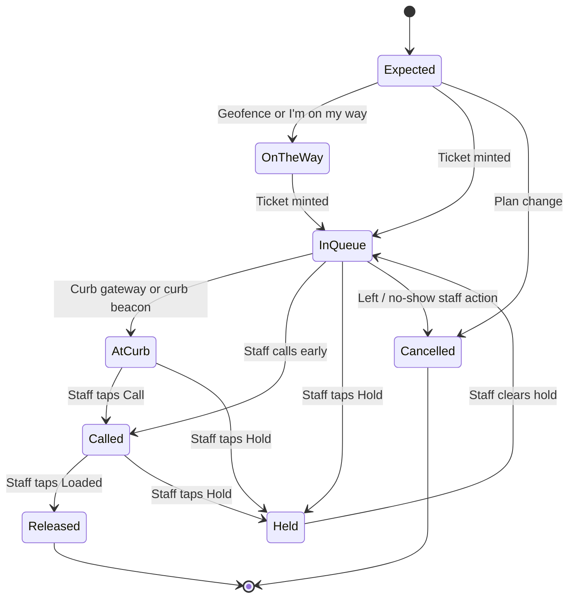

# Carpool and dismissal

This is the wedge. If this afternoon fails, nothing else in the platform matters. The design priority is a correct release to the correct adult, in an order the staff believe, including when phones do not work.

## What a good afternoon feels like

Northbridge Day School, Tuesday, 2:36 p.m. Dismissal window is 2:25–3:15. Cutoff for plan changes was 1:30.

Maya Chen leaves work and opens Portico. Today already says both children are carline with her. She taps **I'm on my way**. The phone wakes a session, estimates distance from the outer fence, and shows "about ten minutes." She does not watch a dot.

At the driveway, a visor fob the school handed her at orientation advertises today's token. A gateway on the fence, powered by the school's ethernet, hears it and posts a sighting. The server issues ticket 18. James's iPad, already on the glare theme, shows the Chen Sienna four cars back, with Maya and Leo's photos. Priya, in grade 2, has not done anything. Her phone lights up only when James taps **Call**: Maya and Leo move to the door. The hallway TV lists their names under CALLED. James matches the adult to the card and taps **Loaded**. The audit row exists before the car reaches the street.

Behind them, David Alvarez has no smartphone session. His fob is enough. A parent with a dead phone and a forgotten fob gives a family code; the substitute searches, confirms the photo, and adds the car by hand. A student whose other household sent a custody block this morning cannot be called at all until Diane and James both enter a PIN and a reason, which they will not do because the block is real.

Nobody drew a polygon. Nobody required the teacher to pre-stage the class. The paper roster is still in James's folder because this is the first term.

## Concepts

| Term | Meaning |
| --- | --- |
| **Dismissal session** | One campus, one date, one lane, one window. Holds tickets and releases. |
| **Transport plan** | The weekday default for a student: carline, bus, walker, aftercare, activity. |
| **Same-day change** | A dated override. Before cutoff it applies immediately. After cutoff the front office approves it. |
| **Vehicle** | One arrival. May include siblings and carpool riders. Has at most one ticket. |
| **Ticket** | A monotonic number for the session. Never reused. Display order can change if staff insert someone ahead; the ticket number does not. |
| **Zone** | On the way, in the lot, at the curb. Not a coordinate. |
| **Release** | A student was handed to a named adult, or self-dismissed under policy, by a named staff member. |
| **Fob** | A battery tag in the visor. Identifies a household arrival, not a child. |
| **Gateway** | A powered radio on the school network. Hears fobs and phone advertisements. |
| **Beacon** | An iBeacon the parent phone can monitor. It does not identify the car by itself. |

A carpool is a vehicle whose riders include students from more than one household, each with an authorization that names the driving household for that date. MVP supports "riding with an already authorized adult," not an open marketplace of drivers.

## Hardware

### Why three radios

GPS near a school driveway is the wrong instrument. The lot is short, the sky is blocked, and the adjacent road false-triggers "arrived." iPhones are also a poor BLE billboard: background advertising is limited and easy to get wrong. iPhones are a decent iBeacon *listener*: Core Location can wake an app on region entry.

So the kit uses each radio for the job it actually does.

| Piece | Job | Depends on parent cellular? |
| --- | --- | --- |
| Parent phone GPS / geofence | Wake the app, coarse "on the way," ETA band | Yes, to upload. Local wake can happen without upload |
| Phone as iBeacon listener | Confirm entry, mid, and curb when the phone can upload | Yes |
| Fob + gateway | Issue the ticket with no parent signal and no smartphone | No |
| Staff iPad | Manual ticket, call, release, offline cache | No, for the action. Syncs later |

Beacons do not replace gateways. Gateways do not know a car is ten minutes away. The phone does not get to assign its own place in line by GPS.

### Kit placement

Per lane:

1. **Entry gateway**, at the point where a car should receive a ticket and not before. A car on the public road must not join the queue. Mount so the read zone is inside the driveway. This is a site-survey decision, not a default radius.
2. **Curb gateway**, at the loading zone, aimed at where cars stop.
3. **Entry beacon, mid beacon, curb beacon**, mounted 2.5–4 m high, clear of a metal sign back (use a spacer). Mid-beacon is optional on short driveways and included in the kit anyway.
4. **Spare beacon** in the office, labeled, not powered on until needed.
5. **Fobs** enrolled to households, two per regular carline family. The $1,800 kit includes a ten-fob starter so install day can begin; paid schools add 10-packs until coverage is complete. Design partners are stocked to two fobs per carline household from the start, because the pilot has to exercise the no-signal path.

### Beacon specification

- iBeacon. UUID identifies the school. Major identifies the lane. Minor identifies the role: entry, mid, curb, spare.
- Transmit power and advertise interval set for a short, stable region. Target a practical wake range of about 15–40 m after the site survey, not the maximum the chip allows. A beacon that wakes every phone in the gym has failed.
- Battery: field-replaceable, target 24 months at the chosen interval. IP65 enclosure. Operating range at least −20 °C to 60 °C.
- Identity is fixed and public by nature of iBeacon. That is acceptable because a beacon says "you are near this school zone," not "this child is here."

### Fob specification

- Advertises a school-scoped token that rotates daily from a key preloaded at enrollment. No name, no student id, no phone number in the packet.
- Server matches the token against a ±2 day window to tolerate clock drift, then rejects the token outside that window.
- Revocation is server-side and immediate for new sightings. A stolen fob stops producing tickets once revoked, even if the radio still shouts.
- Household-level, not child-level. The vehicle still lists only the students that household is authorized to take today.
- Residual risk: a nearby observer can hear a rotating BLE advertisement. They cannot resolve it to a family without the server key, and yesterday's packet fails tomorrow. Document this in the family privacy notice. Do not use AirTags or any consumer tracker network.

### Gateway specification

- PoE, on the school network, outbound HTTPS only. No inbound ports.
- Mutual TLS with a device certificate provisioned at install. Sightings are signed. Replays outside a short time window are dropped.
- Buffer at least twelve hours of sightings if the WAN fails, then flush in order.
- Heartbeat at least every 60 seconds during the dismissal window and every 15 minutes otherwise. Two missed heartbeats during school hours email the school IT contact and show a red row in admin.
- Reads RSSI and token. The zone is "which gateway," not a trilateration theater. Strongest recent gateway wins if both hear the same token; entry gateway is the one allowed to mint a ticket.

Opinionated hardware choice: a small Linux gateway (industrial Pi-class) rather than a microcontroller, so TLS, buffering, and remote support are ordinary. Beacons and fobs stay simple Nordic-class radios. Revisit a cheaper gateway only after a term of heartbeats that never matter.

### Site survey checklist

- Walk the driveway at dismissal speed with a test fob before install day.
- Confirm the entry zone does not cover the public road or the staff parking lot.
- Confirm the curb zone does not include the exit lane where cars are already leaving.
- Confirm PoE and a network drop, or a planned run, for each gateway.
- Confirm the iPad has a mount, a charged spare battery, and school Wi-Fi plus a phone hotspot procedure.
- Photograph mounting points into the admin device record.

## Phone behavior

### When the phone works

1. On a school day, inside the dismissal window, entering the outer geofence (default 1500 m, school-selectable) starts a pickup session.
2. The app sends a coarse zone, not a coordinate trail: far, near, or here, plus a straight-line distance bucket for an ETA band. Speed assumption is school-configured, default 25 mph. No routing API in MVP.
3. The app monitors iBeacon regions for entry, mid, and curb. On entry, it uploads a sighting. If a fob already minted a ticket, the sighting attaches to that vehicle and refines the zone. If no ticket exists, a phone entry sighting may mint one.
4. Curb beacon or curb gateway moves the zone to at the curb. It does not auto-release the student.

### When the parent will not grant location

**I'm on my way** is a first-class start. It records intent and a manually useful status ("parent says they left") without a fake ETA. The fob still mints the ticket at the driveway. Copy must not scold.

### Battery

- No location collection outside the dismissal window or outside the outer fence, even though iOS calls the permission Always.
- High-accuracy GPS is not left running. Region monitoring and a short refresh are the budget.
- Target: under 2% battery on a reference recent iPhone and a mid-range Android for one approach. Measure before the pilot and publish the result in the admin guide. If a device class misses the target, narrow scanning on that class rather than weakening the claim everywhere.
- Android may run a foreground service with a visible notification during the window only. That notification is expected. iOS uses region monitoring rather than a permanent blue bar.

### What we store from the phone

Zone transitions and ticket events. Not a polyline. Not a history of Saturday errands. Raw coordinates, if a platform API forces us to receive one to compute distance, are discarded after reducing to a bucket and are not written to the primary database. Beacon RSSI debugging payloads live 72 hours. The release audit lives seven years and does not include radio measurements. Details in [Security, privacy, and compliance](10-security-privacy-compliance.md).

## Queue rules

1. A session opens automatically at the start of the window and closes at the end, or when an admin ends it.
2. Tickets are integers, start at 1, and are allocated in a single transaction per session so two gateways cannot mint the same number.
3. The first trusted arrival event wins. Priority: entry gateway, then uploaded entry-beacon sighting, then staff manual add. GPS never mints a ticket.
4. A second sighting for the same household updates zone and does not mint a second ticket.
5. Siblings in one vehicle share the ticket. Students are called together.
6. A student already released early is not callable. The arriving parent sees "already picked up" and the adult who was recorded.
7. Staff may park a ticket (vehicle pulled aside) without renumbering. Display order skips parked tickets. The ticket id remains.
8. Staff may insert a vehicle ahead of another only by an explicit "place in front of ticket N" action, audited. Ordinary manual adds go to the end.
9. Parent-visible "cars ahead" counts vehicles not yet released, ahead in display order, in this lane. If the count cannot be computed, omit it.
10. Aftercare and a second window are a separate session later in the day if the school enables one. MVP can configure the times even if most pilots use one window.

### State

Student state is related but separate: in class, called, held, released, early-released, absent. A vehicle can be at the curb while one sibling is held at the nurse. Call lists only the students who are eligible.

## Staff dashboard

Specified visually in [UX and key screens](05-ux-and-key-screens.md). Behavioral rules:

- The now-card is the earliest non-released, non-parked vehicle in display order that is in the lot or at the curb. Cars that are only "on the way" appear in a collapsed count, not as the now-card. Calling a car that is still on the parkway is how students stand in the weather.
- Staff may expand "on the way" to see names and ETA bands when they need to prep a runner. That list is labeled as not yet in line.
- Call moves eligible students on that ticket to called and updates teacher view and porch display.
- Loaded releases those called students to the authorized adult shown on the card. If the adult present is different, staff switch the adult to another person on today's list, or start a two-person override.
- No-show returns the ticket to cancelled after confirmation, and the students return to in class so a later vehicle can take them.
- End-of-day summary: counts of released, early, held, no-show, manual tickets, overrides. Export CSV. This is the page a head of school will ask for in week one.

### Offline

The iPad keeps today's roster, photos that were cached at session start, tickets, and a queue of unsent actions. Staff can call, hold, manually add, and release. When the network returns, actions sync in timestamp order. Conflicts: a release and a block created while offline resolve in favor of the block, and the iPad shows "release needs review" rather than silently winning. This case is rare and must be loud.

## Classroom and porch

- Teacher surface lists called students and dismissal deltas only.
- Porch display lists called names and holds. No photos, no full queue.
- MVP does not send an SMS to a classroom phone. Push to the teacher app and the web view are the contract. Schools that live on radios can keep the radio as a backup; the product does not need to replace the physical radio on day one to be successful.

## Safety and authorized pickup

### Before the afternoon

- Every carline student has a transport plan.
- Every release requires an adult who is authorized for that student on that weekday, or a completed override, or a self-dismiss flag.
- Adding an adult notifies the other custodial guardians.
- A block is an office action. It displays a full-width state on the now-card. Call is disabled.
- Same-day changes after cutoff do not change the curb card until approved.
- Student photos shown at the curb are school-approved. A parent upload is not live until the school accepts it, or the school turns on "trust parent photos" explicitly.

### At the car

Staff match the card to the person and the car description the household provided (color, model, optional plate). MVP does not scan plates and does not promise plate recognition. The plate is a human hint.

Override (adult not on the list, or student blocked):

1. Staff A starts override and selects the student.
2. Staff B, a different user, approves with PIN.
3. Both names, the reason, and a short free-text note are stored.
4. School admin is notified the same day.
5. The student is released only after step 2. There is no "override and sync later" on a single PIN.

### Custody limits

Portico enforces the school's instructions. It is not a court and does not interpret an order. The admin UI asks for the operational consequence: who may pick up, who is blocked, through which date. A scanned letter can be attached for the office. The attachment is not shown on the iPad.

### Self-dismiss and walkers

Separate from the car queue so a walker is not ticketed. Staff see a walker list they can mark released-as-walker in bulk if the school wants a headcount, or ignore if the school does not track walkers that tightly. Default: record the planned mode, do not require a tap per walker in MVP. The school can switch on "confirm walkers" if they want the headcount.

### Early pickup

Front office records early release against the same release event type. The student drops out of the callable set. An arriving carline parent is told who took the child and when. That disclosure goes to custodial guardians, not to every authorized fob holder.

### Households with no phone

Family code card, printed from the admin console, plus optional fob. The code is short, unique per household per school year, and rotatable. Staff search is fast enough to use while a car idles. Schools must not be told that "everyone has a smartphone."

## Fallback matrix

| Failure | What still works | What staff do |
| --- | --- | --- |
| Parent cellular dead zone | Fob + gateway mint a ticket | Nothing, if the fob is in the car |
| No fob, phone online | iBeacon upload or "I'm on my way" plus manual confirm if beacon missed | Search if no ticket appears |
| No fob, phone offline | Manual identity | Family code or student name |
| Parent declined location and Bluetooth | Fob, or manual | Treat as no-smartphone if they also forgot the fob |
| Gateway down | Phone beacon upload, manual | IT alert; other gateway may still mark the curb |
| School WAN down | Gateways buffer; iPad works from cache; manual release | Paper roster if the iPad is also dead |
| iPad dead | Second device on the URL, or paper | Paper roster is mandatory in term one |
| Beacon battery dead | Gateway + fob still ticket; phone loses iBeacon wake | Replace from spare; do not block dismissal |
| Wrong ticket order | Staff park, reorder, or manual add | Correction is an audit event, not a bug to hide |
| Custody surprise at the curb | Call disabled | Office contact; two-person override only if the school truly intends to release |

The paper roster lists student, grade, teacher, planned mode, and blocked yes/no. It refreshes each morning from an admin download. Term one exit criterion includes "the school still knows where the paper is."

## Weather, drills, and early close

- **Delay broadcast** pushes a vague lock-screen notification and an in-app banner. It does not by itself change tickets.
- **Early close** moves the window if an admin confirms. Cutoff rules for changes should already have passed; staff rely on the plan plus manual adds.
- **Fire drill during dismissal** is an operational pause. Staff tap a line pause that freezes new calls and posts "paused" on the porch display. Tickets are not cancelled.
- Reunification (parents picking up from a gym after an incident) is a later mode. Do not overload the carline UI with it in the pilot. Do keep release events and authorized adults general enough to reuse.

## User stories and acceptance criteria

### Story: ticket without signal

**As a** parent in a dead zone at the driveway, **I want** my place in line saved by the fob, **so that** staff are not guessing.

**Acceptance criteria**

- Given a fob with today's valid token enters the entry gateway and the parent's phone has no packet service, when the gateway can reach Portico, then a ticket is minted without any phone upload.
- Given that ticket, when the parent later regains service, then the app shows the same ticket and does not mint a second one.
- Given the fob was revoked this morning, when it is heard, then no ticket is minted and the gateway sighting is stored as rejected for 72 hours.

### Story: GPS cannot steal a place

**As a** carline lead, **I want** cars on the public road to stay out of the numbered line, **so that** I do not call students for a car that is still on the far side of the fence.

**Acceptance criteria**

- Given a phone reports the outer geofence, when no gateway or entry beacon or staff action has occurred, then the vehicle is "on the way" and has no ticket.
- Given that vehicle is the only "on the way" car, when the now-card renders, then the now-card is empty or shows the next in-lot car, never the geofenced car.
- Given a test handset sits on the public road for five minutes, when staff review tickets, then no ticket exists for it.

### Story: siblings are one stop

**As a** parent of two, **I want** one ticket for my car, **so that** the younger child is not called ten minutes before the older.

**Acceptance criteria**

- Given two students share a vehicle, when a ticket is minted, then both are attached and the queue counts one car.
- Given staff tap Call, when the teacher views update, then both students show called.
- Given one sibling is on hold at the nurse, when staff tap Call, then the eligible sibling is called and the held sibling is visibly excluded.

### Story: cutoff is real

**As a** front-office admin, **I want** late plan changes to wait for me, **so that** the curb is not honoring a text the teacher never saw.

**Acceptance criteria**

- Given the cutoff is 1:30 p.m. school time, when a guardian submits a change at 1:29, then today's plan updates and carline staff see it without approval.
- Given a change at 1:31, when it is submitted, then the curb card is unchanged, the guardian sees "waiting for the office," and the office sees an approval task.
- Given the office rejects it, when the guardian refreshes, then the original plan remains and the reason is shown.

### Story: override is uncomfortable on purpose

**As a** head of school, **I want** a release outside the list to require two staff, **so that** a single substitute cannot be pressured into it.

**Acceptance criteria**

- Given the adult is not authorized, when one staff member completes only their PIN, then the student remains unreleased.
- Given both PINs and a reason are entered, when the release saves, then the audit shows both staff ids and school admin is notified.
- Given the iPad is offline and the student is blocked, when staff attempt release, then the release is refused or quarantined for review, and it does not display as a normal successful release.

### Story: teacher does nothing on a normal day

**As a** teacher, **I want** an empty dismissal list when nobody has been called and nothing changed, **so that** I can teach until the first name appears.

**Acceptance criteria**

- Given no changes and no calls, when the teacher opens the view, then the primary content is "No dismissal changes" and there is no required button.
- Given a student in the class is called, when the view is foregrounded on a healthy connection, then the name appears within two seconds of the staff tap.

### Story: already picked up

**As a** parent arriving by car, **I want** to be told if my child left early with the other household, **so that** I do not wait in line for a child who is gone.

**Acceptance criteria**

- Given an early release was recorded, when the carline session is active and the guardian opens the app, then they see the time and the adult's name.
- Given a fob for a different authorized adult is heard after that release, when the gateway posts it, then no new ticket is minted for the already-released student, and staff see an informational "already released" if the rest of the vehicle is empty.

## Out of scope for this module

License-plate cameras, facial recognition, predictive "leave now" traffic coaching, multi-lane optimization, student-carried trackers, and any parent-visible live map. Bus manifests can be a transport mode and a printed list in Campus; bus routing is not a Portico problem.
