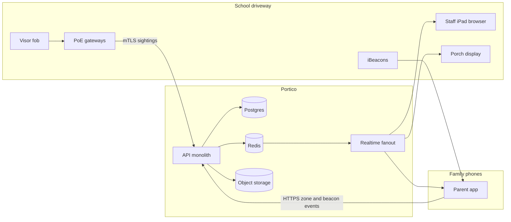
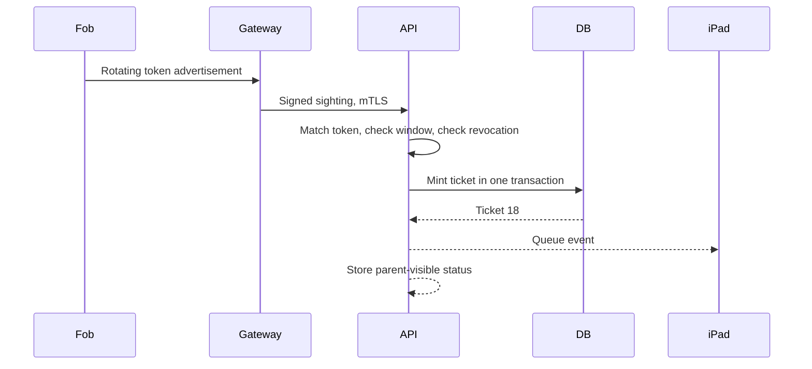

# Architecture

A modular monolith with a hard realtime path for dismissal. The curb is a latency and reliability problem. Lunch and grades are ordinary web applications that should not force the queue into a distributed system.

## Shape



One write path mints tickets: the API, in a database transaction, after it decides the sighting is trusted. Gateways and phones are not allowed to choose the ticket number.

## Stack

| Concern | Choice | Why |
| --- | --- | --- |
| Parent and teacher mobile | React Native with prebuild (development builds, not Expo Go) | One UI codebase, real iOS location and iBeacon hooks |
| Staff queue, porch display, admin | Next.js web app | Ship a fix at 1:00 p.m. without App Store review. iPad Safari is the staff client |
| API | TypeScript, single deployable, modular packages per context | A small team can hold the release bar. Split only when a module has a separate scaling story that has actually happened |
| Primary database | PostgreSQL, row-level security | Relational tenancy, constraints, audit |
| Live queue | Redis pub/sub plus a Postgres source of truth | Fanout to iPads and TVs. Redis is not the system of record |
| Object storage | S3-compatible, private buckets | Photos, report-card PDFs, custody attachments |
| Auth | WorkOS | Google, Microsoft, and SAML for schools that grow into it. Parents are magic link and SMS OTP, not SAML users |
| Payments | Stripe Connect + Financial Connections | School is merchant. Portico is the platform. See [D16](decisions.md) |
| Push | APNs and FCM | Direct, no extra marketing SDK |
| SMS and email | A transactional provider (Twilio-class SMS, Postmark-class email) | OTP and a small set of operational messages |
| Observability | OpenTelemetry, structured logs, error tracking | No student names in logs |

Rejected for the pilot: microservices per module, a native Swift and Kotlin double build, Supabase-as-the-product, self-hosted auth, and any analytics SDK that is in the business of profiles.

## Processes

The monolith is one codebase and two process types so a gradebook export cannot starve dismissal:

- **API and realtime**, scaled for dismissal peaks. Handles tickets, releases, auth, and admin CRUD.
- **Worker**, for CSV import, PDF render, email, payout reconciliation, and retention deletion.

Both share the database. The worker is not in the request path for Call or Loaded.

## Tenancy

Every tenant-owned row carries `school_id`. Postgres RLS policies require it to match the session school. Application code also sets school scope in queries. Both layers exist because one of them will eventually be missed.

Portico staff use a break-glass role that writes an audit row before RLS will allow the select. The school can read those audit rows.

A diocese with many schools is many tenants with a later "group admin" read model, not one giant tenant. Do not merge schools into one `school_id` to make billing pretty.

## Realtime

Staff iPad, porch display, teacher view, and parent ticket view subscribe to the dismissal session.

- Events: ticket minted, zone changed, called, held, released, paused, session closed.
- Payload is the smallest card the client needs, already authorized for that subscriber. The server does not send the whole roster on every event.
- Reconnect fetches a snapshot, then resumes events. Clients treat the snapshot as truth if an event was missed.
- Target: p95 under two seconds from committed release to visible card on school Wi-Fi. See [Non-functional requirements](11-non-functional-requirements.md).

WebSockets are the right default. If a school network blocks them, the porch display and iPad fall back to SSE or short polling at two-second intervals during the window only. Detect the failure and switch; do not make the carline lead change a setting.

## Carline trust boundary



Phone-originated beacon sightings use the parent session instead of mTLS, and they can mint a ticket only for a household the signed-in guardian belongs to. A phone cannot submit a sighting for an arbitrary family.

## Deployment

- US region only for the pilot. Single primary region, multi-AZ database.
- Infrastructure as code from the first environment. Production and a staging tenant with fake students, never a copy of a real school.
- Web and API on a managed container service. Avoid a platform that cannot do WebSockets.
- Secrets in a managed secret store. No production keys in the mobile binary except publishable Stripe keys and a public API host.
- Mobile binaries distributed through TestFlight and Play internal tracks for design partners, then public stores. The staff experience does not wait on that review because it is the web queue.
- Feature entitlements are rows in Postgres (`school_entitlements`), read by the API. Not a third-party flag service the curb depends on.

## Client rules

- Parent app stores the current session status and the family code locally. It does not store other families. It does not store a location history.
- Staff iPad cache holds today's session only, encrypted at rest using the platform store, and is wiped at sign-out and at the end of the next successful sync after session close.
- Photos on the iPad are thumbnails for today's callable students, not the original uploads.
- The admin console is a normal authenticated web app. CSV import is a worker job with a review step before commit. Nothing in an uploaded file is active because it parsed.

## Suggested repository layout (when code exists)

This specification does not add that code. When it does, prefer:

```
apps/api          modules: identity, dismissal, attendance, lunch, billing, academics, chat
apps/web          admin, staff queue, porch, teacher
apps/mobile       parent and teacher React Native
firmware/         gateway agent and fob/beacon notes
packages/domain   shared types and permission checks
```

Permission checks live in one module imported by API and by tests. Do not reimplement "can this guardian see this student" in the client.

## Environments and data

| Environment | Data |
| --- | --- |
| Local | Seed school, fictional families, no real photos of minors |
| Staging | Same, plus contract tests for gateways using recorded sightings |
| Production | Real schools, isolated by RLS, backups encrypted |

Never refresh staging from production. Build fixtures that cover custody blocks, two households, and a no-phone family. Those fixtures are more useful than a realistic copy.

## Build-versus-buy

| Build | Buy |
| --- | --- |
| Household and custody model | SSO and SAML (WorkOS) |
| Ticket allocation and release audit | Card and ACH processing (Stripe) |
| Gateway agent and token verification | Transactional SMS and email |
| Lunch ledger and tuition ledger | Push transport (APNs, FCM) |
| Gradebook | Maps, for as long as [D6](decisions.md) holds; there is nothing to buy |
| Moderation workflow for class rooms | Device management for school iPads (the school already has, or does not need, an MDM for one web app) |

## Failure domains

| Failure | Dismissal behavior |
| --- | --- |
| API unavailable | iPad serves cache and queues actions. Gateways buffer sightings. New logins fail. Paper roster if the cache is cold |
| Redis unavailable | API still commits tickets to Postgres. Clients poll the snapshot endpoint until fanout returns. Slower, still correct |
| Postgres primary failover | Brief write errors. Clients retry idempotent ticket requests. Ticket minting uses an idempotency key from the gateway sighting id so failover does not double-issue |
| Object storage unavailable | Queue still works with initials if a thumbnail fails. Do not block Call on a photo fetch |
| Push provider down | In-app status and the porch display still update. Teachers with the view open are fine. Document that push is not the safety channel |

Idempotency keys are required on sightings, manual adds, and payment writes. Retries are normal on a driveway.

## Security architecture (summary)

The full control set is in [Security, privacy, and compliance](10-security-privacy-compliance.md). Architecturally:

- TLS everywhere, mTLS for gateways
- RLS plus application checks
- Append-only audit table, no updates
- Photos and documents via short-lived signed URLs
- PII banned from logs by a logging helper, not by policy alone
- Separate Stripe account objects per school, platform fee explicit on PaymentIntents when a fee applies

## What can wait

Multi-region active-active, a public API, offline-first parent sync, GraphQL, and a dedicated realtime cluster. Add them when a measured bottleneck or a signed contract requires them, not because the diagram looks small.
